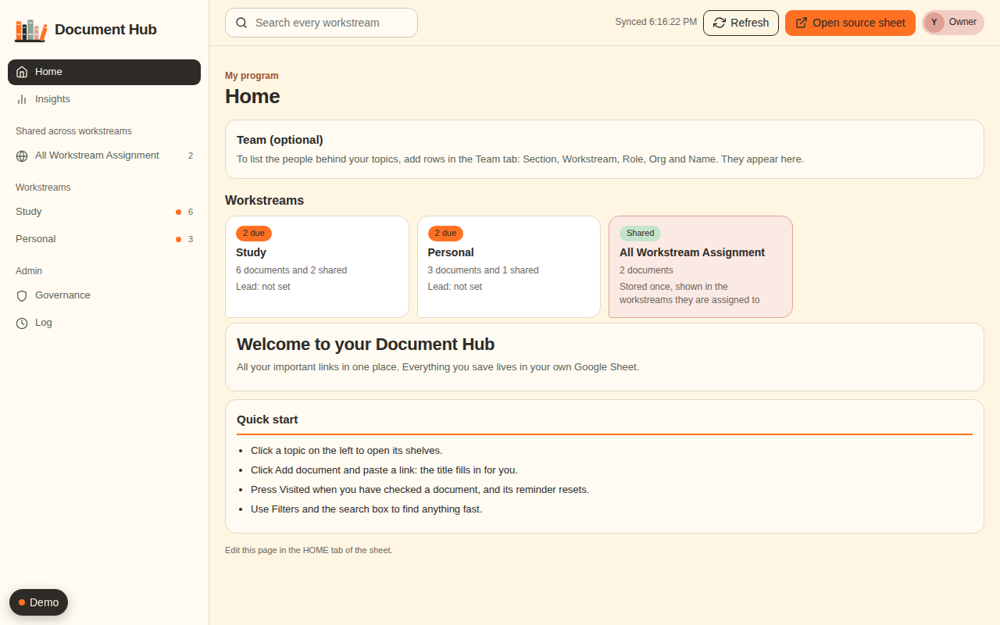
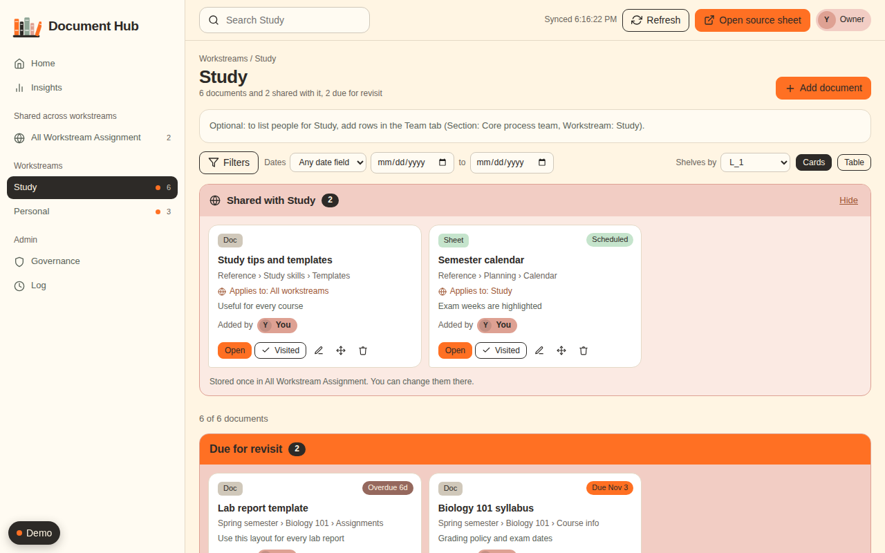
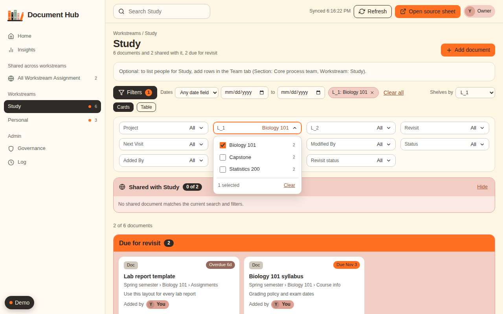
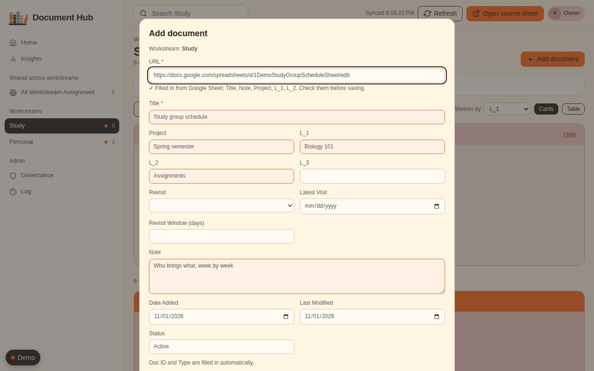
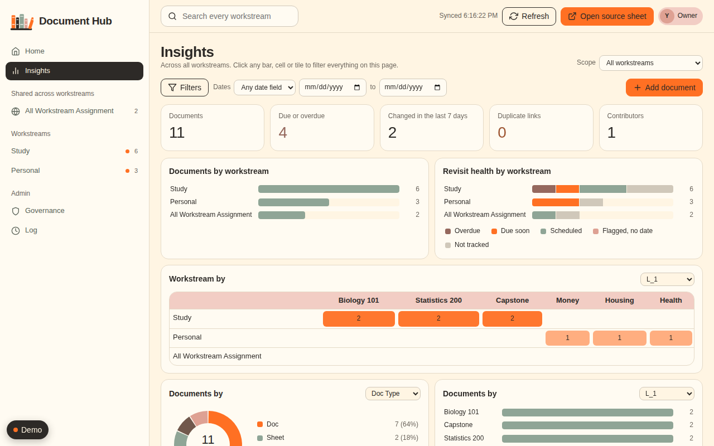
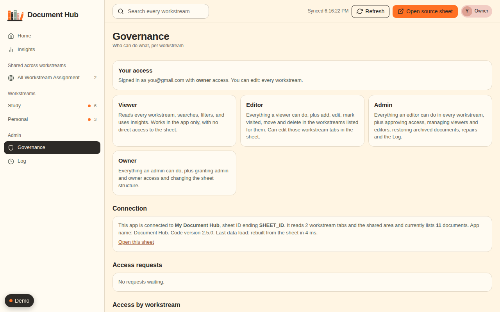
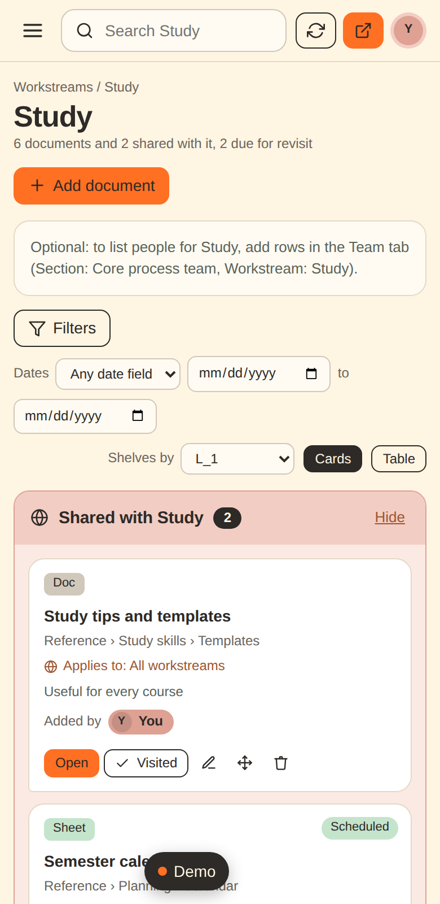
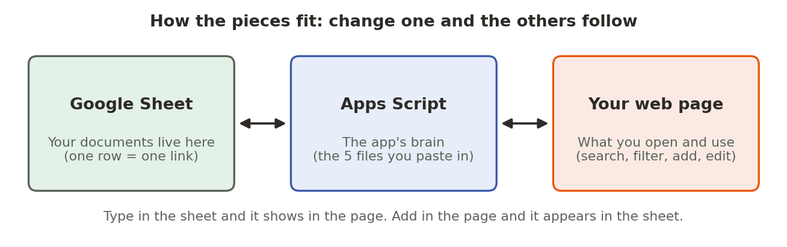
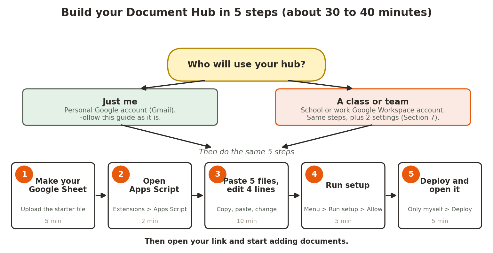

# Build your own Document Hub

A Document Hub is a private web page for all your important links: course notes, project files, checklists, anything. You keep them in a Google Sheet. The hub shows them as a searchable library with shelves, filters and reminders to revisit.

This guide is for **students and individuals using a personal Google account** (a free Gmail account is fine). You do not need to know how to code. It takes about **30 to 40 minutes**.

## See what you will get

Here is the finished hub, running on sample data.

<table>
<tr>
<td width="50%"><br><sub><b>Home</b>: one card per topic and your own welcome page</sub></td>
<td width="50%"><br><sub><b>A topic</b>: shelves of cards, plus a reminder strip for documents due</sub></td>
</tr>
<tr>
<td width="50%"><br><sub><b>Filters</b>: tick several values at once</sub></td>
<td width="50%"><br><sub><b>Add a document</b>: paste a link and the title fills itself in</sub></td>
</tr>
<tr>
<td width="50%"><br><sub><b>Insights</b>: charts that filter each other when you click</sub></td>
<td width="50%"><br><sub><b>Governance</b>: who can see and change what (for teams)</sub></td>
</tr>
</table>

It also works on a phone:



### Try it yourself before you build

The demo is the **real hub** running on a pretend spreadsheet, so you can click everything. Nothing you do is saved to Google. Your changes stay only while the tab is open.

- **Open it from your computer (easiest).** Double-click `docs/demo.html` from the starter kit. It opens in Chrome.
- **Open it from your GitHub repo.** GitHub shows HTML files as plain text, so turn on GitHub Pages once:
  1. Put the `docs` folder (with `demo.html` inside) in your repo.
  2. Go to **Settings > Pages**. Under **Build and deployment**, set **Source** to **Deploy from a branch**, **Branch** to `main`, and the folder to **/docs**. Click **Save**.
  3. Wait a minute or two. The page shows your link: `https://YOUR-USERNAME.github.io/YOUR-REPO/demo.html`. Paste that link at the top of your README.

**Things to try in the demo**
1. Click the **Demo** button (bottom left). Under **Try pasting a link**, click **Copy link** on the first sample.
2. Open **Study**, click **Add document**, and paste the link. Watch the title and details fill in.
3. Paste the third sample link (the private one). Nothing is filled in, and that is on purpose.
4. In the **Demo** panel, use **View the hub as** to switch between **Owner**, **Editor** and **Viewer**. This shows what a classmate or teammate would see.
5. Click **Reset demo** to start again.

---



## The whole process at a glance



<details>
<summary>Can't see the picture? Same thing in text.</summary>

```
Who will use it?
  ├─ Just me (personal Google account) ──► follow this guide as it is
  └─ A class or team (school/work Workspace) ──► same steps + 2 settings (Section 7)

Step 1  Make your Google Sheet        (upload the starter file)       5 min
Step 2  Open Apps Script              (Extensions > Apps Script)      2 min
Step 3  Paste 5 files, edit 4 lines   (copy, paste, change)          10 min
Step 4  Run setup                     (menu > Run setup > Allow)      5 min
Step 5  Deploy and open it            (Only myself > Deploy)          5 min
```
</details>

## Before you start

**You need**
- A **personal Google account** (Gmail). School or work accounts often block this; if yours does, use a personal one.
- A **laptop or desktop with Chrome**. Do not try this on a phone.
- The files that came with this guide:
  - `document-hub-starter.xlsx` (your starting sheet)
  - `document-hub.zip` (the app: five files inside)
  - `docs/demo.html` (optional: the interactive demo above)

**Decide**
- Which topics you want. The starter has two: **Study** and **Personal**. Each topic becomes its own tab and its own page. (In the app, a topic is called a **workstream**.)

**Good to know**
- With a personal account the hub is **just for you**. Google does not tell the app who other visitors are, so it cannot share the page with friends. Section 7 explains your options.

---

## Step 1. Make your Google Sheet (5 min)

1. Go to **sheets.google.com** and click **Blank spreadsheet**.
2. Click **File > Import > Upload**, choose `document-hub-starter.xlsx`, then select **Replace spreadsheet** and click **Import data**.
3. Click the title (it says "Untitled spreadsheet") and rename it, for example **My Document Hub**.
4. Look at the two tabs at the bottom, **Study** and **Personal**. Row 3 holds the column names. **Do not change row 3.**
5. Row 4 is a sample. Replace it with your own first document, or leave it for now.
6. To add another topic: right-click a tab, choose **Duplicate**, rename it, and delete its sample row.
7. Copy your **sheet ID** into a note. It is the long text in the address bar between `/d/` and `/edit`.

> Tab names to avoid, because the app keeps them for itself: `HOME`, `Team`, `Access`, `Access_Requests`, `Audit_Log`, `Archive`, `Config`, `Project_Spec`, `All Workstream Assignment`.

✅ **Check:** every topic tab has **Title** in A3 and **URL** in B3.

---

## Step 2. Open Apps Script (2 min)

1. In your sheet, click **Extensions > Apps Script**. A new tab opens.
2. In the left menu click the **gear (Project Settings)** and tick **Show "appsscript.json" manifest file in editor**.
3. Click the **`<>` (Editor)** icon in the left menu to go back.

---

## Step 3. Paste the files and change 4 lines (10 min)

1. Unzip `document-hub.zip`. You will see `Code.gs`, `Setup.gs`, `Spec.gs`, `Index.html` and `appsscript.json`.
2. Open each file in **Notepad** (Windows) or **TextEdit** set to plain text (Mac: **Format > Make Plain Text**). Press **Ctrl+A** then **Ctrl+C** to copy.
3. Paste each one into Apps Script:

| Package file | What to do in Apps Script |
|---|---|
| `Code.gs` | Click `Code.gs`, select all, paste over it |
| `Setup.gs` | Click **+** next to Files, choose **Script**, name it `Setup`, paste |
| `Spec.gs` | **+ > Script**, name it `Spec`, paste |
| `Index.html` | **+ > HTML**, name it `Index`, paste |
| `appsscript.json` | Click `appsscript.json`, select all, paste over it |

4. Change these **four things**:

| Where | Find | Change it to |
|---|---|---|
| `Code.gs` (line 7) | `var SS_ID = 'PASTE_YOUR_SHEET_ID_HERE'` | your sheet ID from Step 1, between the quotes |
| `Code.gs` (line 8) | `var DOMAIN = 'gmail.com'` | the part of your email after the @. Leave it if your email ends in `@gmail.com`. |
| `Code.gs` (line 9) | `var OWNER_SEED = 'you@gmail.com'` | your full email, for example `'sam@gmail.com'` |
| `appsscript.json` | `"access": "DOMAIN"` | `"access": "MYSELF"` |

Optional: in `appsscript.json`, change `"timeZone"` to yours, for example `"Europe/London"`.

5. Press **Ctrl+S** on every file to save.

✅ **Check:** `Code.gs` no longer says `PASTE_YOUR_SHEET_ID_HERE` or `you@gmail.com` (unless that really is your email), and there are no red error marks.

---

## Step 4. Run setup (5 min)

1. Go back to your sheet tab and press **F5** to reload. After a few seconds a new menu appears next to **Help**. It is called **Document Hub** (you can rename it later).
2. Click **Document Hub > Run setup**.
3. Google asks for permission:
   - Click **Review permissions** and choose your account.
   - If it says **"Google hasn't verified this app"**, click **Advanced**, then **Go to (your project) (unsafe)**. This is your own script, so it is safe.
   - Click **Allow**.
4. If nothing seems to happen after you allow, choose **Run setup** once more.
5. Wait for a message that starts **"Setup complete"**. It counts one more tab than you made, because the app adds a shared area for documents that belong in several topics (for the starter file it says 3).

Setup builds the extra tabs the app needs, fills in the document IDs and types, adds you as the owner, and saves one backup copy of your sheet in Drive.

✅ **Check:** you see the "Setup complete" message and new tabs such as `Access`, `Config` and `All Workstream Assignment`.

---

## Step 5. Deploy and open it (5 min)

1. In Apps Script, click **Deploy > New deployment**.
2. Click the **gear** next to "Select type" and choose **Web app**.
3. Set **Execute as: Me** and **Who has access: Only myself**.
4. Click **Deploy**, then **Authorize access** if asked, and copy the **Web app URL**.
5. Open the URL in Chrome and **bookmark it**. This is your hub.

✅ **Check:** you see a home page with a card for **Study**, one for **Personal**, and a **Shared** card. Open **Governance** and look at the **Connection** card: it should show your sheet's name.

---

## 6. Using your hub

**Add a document.** Open a topic and click **Add document**. **Paste the link first.**
- For Google Docs, Sheets, Slides, Forms and Drive links, the app fills in the title and any details it can read. Check them, then save.
- For any other link, type the title yourself.

**Edit, delete, revisit.** Use the pencil, bin and **Visited** buttons on a card. Deleted items go to the `Archive` tab, so you can get them back.

**Reminders.** Type `Y` in **Revisit**, a **Latest Visit** date and a **Revisit Window (days)**. The hub then tells you when the document is due.

**Prefer the sheet?** You can type or paste rows straight into the topic tabs. They appear in the hub within about 30 seconds, or click **Refresh**.

---

## 7. Sharing with other people

**With a personal Google account, only you can open the hub.** This is a Google rule: when a web app runs as its owner, it cannot see who other visitors are. The hub depends on knowing that, so it can only work for you.

What you can do instead:
- **Share the Google Sheet itself** (View only) with friends. They read your list, but not the hub page.
- **Use a school or company Google Workspace account** (if it lets you create Apps Script). Then a whole class or team can use the hub. Change two settings:
  1. In `Code.gs`, set `DOMAIN` to your organisation's domain (for example `'school.edu'`).
  2. In `appsscript.json`, set `"access": "DOMAIN"`. When you deploy, choose **Anyone within (your domain)**.

  People then open the link, request access, and you approve them in **Governance**. The demo's **View the hub as** menu shows what an editor or a viewer would see.

---

## 8. Make it yours (optional)

| What | How |
|---|---|
| **App name** | In the `Config` tab, change `APP_TITLE`. Also find and replace `Document Hub` with your own name in `Setup.gs` and `Index.html`. |
| **Logo** | The package has a simple bookshelf icon. In `Index.html` find `const LOGO=` and replace the long `data:image/png;base64,…` text with your own small PNG (about 130 × 120 pixels), converted with any "image to base64" tool. |
| **Colours** | In `Index.html`, find the block with `--orange`, `--ash` and `--cloud`, and change the colour codes. |
| **Shelf order** | In the `Config` tab, list shelf names in `SHELF_ORDER`, separated by commas. |

Use a logo you are allowed to use. The bookshelf icon and the warm colours are free to keep.

---

## 9. If something goes wrong

| What you see | What to do |
|---|---|
| No new menu in the sheet | Reload the sheet (F5) and wait a few seconds. |
| "This script is attached to a different spreadsheet" | `SS_ID` in `Code.gs` is not this sheet's ID. Fix it and save. |
| "No workstream tabs found" | Each topic tab needs **Title** in A3 and **URL** in B3. |
| "Google hasn't verified this app" | Click **Advanced > Go to (project) (unsafe) > Allow**. It is your own script. |
| "Sign in with your … account" or "limited to … accounts" | `DOMAIN` is wrong. Set it to the part of your email after the @, and sign in with that account. |
| "Couldn't load the app" | Run **Run setup** again, then **Deploy > Manage deployments > pencil > New version > Deploy**. |
| Deploy shows an error about access | Check `appsscript.json` says `"access": "MYSELF"`. |
| A sheet change is not in the hub | Click **Refresh**. |
| You cannot allow permissions | Your school may block it. Use a personal Google account. |

---

## 10. Update later

1. Replace the changed files in Apps Script, and check your four settings from Step 3 are still yours.
2. In the sheet, click **Document Hub > Sync project spec**.
3. In Apps Script click **Deploy > Manage deployments > pencil > Version: New version > Deploy**.

Your link stays the same and your data is not touched.

---

## 11. Ask Claude to help

If you get stuck or want changes, give Claude `document-hub.zip` and say:

> I am building a personal Document Hub with a personal Google account. Help me [fix this error / change the colours / add a new shelf]. Here is what I see: [paste the message or a screenshot].

---

## Checklist

Tick one box per action. Each group matches a step above.

**Step 1: Sheet**
- [ ] Created a new Google Sheet from the starter file
- [ ] Renamed the sheet (for example, My Document Hub)
- [ ] Left the column names in row 3 unchanged
- [ ] Copied my sheet ID into a note

**Step 2: Apps Script**
- [ ] Opened **Extensions > Apps Script**
- [ ] Turned on **Show "appsscript.json" manifest file in editor**

**Step 3: Files**
- [ ] Pasted `Code.gs`
- [ ] Pasted `Setup.gs` (new script file)
- [ ] Pasted `Spec.gs` (new script file)
- [ ] Pasted `Index.html` (new HTML file)
- [ ] Pasted `appsscript.json`

**Step 3: Settings**
- [ ] Set `SS_ID` to my sheet ID
- [ ] Set `DOMAIN` to the part of my email after the @
- [ ] Set `OWNER_SEED` to my full email
- [ ] Set `"access": "MYSELF"` in `appsscript.json`
- [ ] Saved every file with **Ctrl+S**

**Step 4: Setup**
- [ ] Reloaded the sheet and saw the **Document Hub** menu
- [ ] Clicked **Run setup**
- [ ] Allowed the permissions
- [ ] Saw the "Setup complete" message

**Step 5: Deploy**
- [ ] Created a **New deployment** of type **Web app**
- [ ] Chose **Execute as: Me**
- [ ] Chose **Who has access: Only myself**
- [ ] Copied the **Web app URL**
- [ ] Opened the URL and bookmarked it

**First use**
- [ ] Added my first real document
